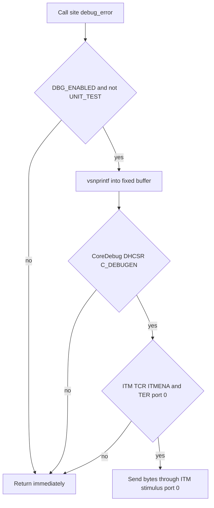

# Debug Preparation and Error-Handling Plan

## Scope and Constraints

- Target: STM32F401 3D printer firmware in `Core/`.
- Do not read or modify `Inc/fake_hal.h`.
- Do not change existing code logic; add validation, diagnostics and safe-return paths only.
- Follow the skill intent while respecting project rules: variadic logging FUNCTIONS, no variadic macros, no `goto`, no function pointers, bounded loops.
- Release builds must not emit diagnostics; diagnostics are active only when `DEBUG` is defined and `UNIT_TEST` is not.
- No compilation and no test execution in this phase. Only a manual syntax review is performed.
- The three error-path defects found during analysis are documented, not fixed.

## Debug Layer Design

### New files

- `Inc/debug.h`
  - `#error` if both `DEBUG` and `NDEBUG` are defined.
  - `DBG_ENABLED` is 1 only when `DEBUG` is defined and `UNIT_TEST` is not.
  - Declares `debug_error`, `debug_warn`, `debug_info`, `debug_debug`, `debug_assert_failed`.
  - `ASSERT(cond)` expands to one expression: `((cond) ? (void)0 : debug_assert_failed(#cond, __FILE__, __LINE__))`.
  - Under `UNIT_TEST`, provides `static inline` no-op stubs so unit-test translation units do not need `debug.c` or the real HAL.
  - Does not include HAL headers when `UNIT_TEST` is defined.
- `Src/debug.c`
  - Implements the variadic functions with `va_list` and `vsnprintf` into a fixed-size stack buffer.
  - Writes through ITM stimulus port 0 only after checking `CoreDebug->DHCSR`, `ITM->TCR` and `ITM->TER`.
  - Provides a strong, guarded `__io_putchar` so the weak `_write` in `src/syscalls.c` becomes safe without editing the generated file.
  - Is not compiled into `UNIT_TEST` builds.

### Logging flow

## Error-Handling Changes by File

| File | Change |
|---|---|
| `Src/main.c` | Include `debug.h`; check `HAL_Init`, PWM start calls, base timer start and ADC DMA start; log failures; enhance `Error_Handler` with logging. Keep state machine unchanged. |
| `Src/stm32f4xx_it.c` | Fault handlers dump the exception frame and fault status registers, then halt. Diagnostics only. |
| `Src/stepper_motor.c` | Validate motor, timer, direction port, channel and direction value; log invalid period. Safe return without changing valid-path behavior. |
| `Src/axis.c` | Validate motor and buffer pointers; log failed buffer pop. |
| `Src/circ_buf.c` | Validate handles, element size and buffer size; guard multiplication overflow; clamp skip; return 0 on invalid input. |
| `Src/usb_praser.c` | Validate frame pointer and length; prevent unsigned underflow in `frame_size - read_frame_bytes`; log truncated pushes. Routing unchanged. |
| `Src/protocol_praser.c` | Validate buffers; clamp payload length to `MAX_PAYLOAD_SIZE`; log unknown frame types; check transmit results. Protocol unchanged for valid frames. |
| `Src/emergency_stop.c` | Check every HAL stop/start return code and log failures; always attempt all channels. |
| `Src/pid.c` | Guard `dt <= 0`, invalid output range and timer period; log; return safe values. |
| `Src/system_check.c` | Add a `getErrorCode` wrapper matching the header; log timeout attempts. Error mask logic left unchanged. |
| `DOCUMENTATION.md` | Add Debugging and Error Handling notes plus a Known Issues section. |
| Build configuration | Document manual settings outside `Core/`: define `DEBUG`, use `-O0 -g3`, add `-specs=nano.specs`. |

## Known Issues Left Untouched

1. `Src/system_check.c` uses `error_code |= (~0x02)`, which sets almost every bit instead of clearing the timeout bit.
2. `Src/protocol_praser.c` checks `circ_buf_capacity()` rather than available space, so a busy transmit path can silently truncate a queued frame.
3. `Src/main.c` ADC completion callback uses `ADC_SUM[0]` for both the bed and print-head PID inputs and never clears the accumulator.
4. `Src/usb_praser.c` can underflow when the accumulated frame length exceeds the declared frame size; the new guard detects it but does not redefine framing.
5. `Inc/system_check.h` declares `getErrorCode()` while the implementation is `get_error_code()`; the wrapper resolves the link name only.
6. `Src/protocol_praser.c` accepts `payload_len` up to 255 while the payload array is 12 bytes; the new clamp prevents overflow on malformed frames only.

## Verification Policy

- Manual syntax review only.
- No compiler invocation.
- No unit-test execution.
- `UNIT_TEST` compatibility is preserved by keeping `debug.h` free of HAL includes and by providing inline stubs.
